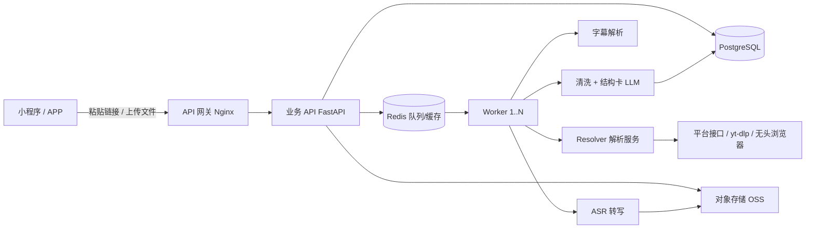

# 技术架构与技术选型

## 1. 全链路



**核心原则：解析层与业务层分离。** 平台签名一变，只重启 resolver，不影响下单、会员、素材库。

## 2. 组件职责

| 组件 | 职责 | 选型 | 备注 |
|---|---|---|---|
| 客户端 | 粘贴、上传、展示 | 微信原生 + uni-app | 复用你现有 uni-app 经验出 APP |
| API | 鉴权、额度、任务、支付 | FastAPI (Python 3.12) | 已有可运行骨架 `06-代码/server` |
| 队列 | 任务排队、重试、削峰 | Redis + RQ/Celery | 单机初期可直接 asyncio，>50 并发再上 |
| 数据库 | 用户/任务/稿件/订单 | PostgreSQL 16 | 初期 SQLite 也能跑，但支付与并发必须换 PG |
| 对象存储 | 原文件、导出文件 | 阿里云 OSS / 腾讯 COS | 生命周期 24h 自动删 |
| CDN | 封面、导出下载 | OSS + CDN | 注意腾讯 COS 默认域名会强制下载 html |
| 解析 | 平台链接 → 媒体/字幕 | yt-dlp + 自研 + 无头浏览器 | **单独部署，可换 IP** |
| ASR | 音频 → 带时间戳文本 | 火山/阿里 + faster-whisper 兜底 | 字幕优先，ASR 兜底 |
| LLM | 结构卡、二创 | 混元 / deepseek-flash | 15s 超时，禁止用 pro |
| 监控 | 成功率、耗时、成本 | Prometheus + Grafana / 自建看板 | 按平台分维度 |

## 3. 任务流（以抖音链接为例）

```
1. 客户端 POST /api/parse  → 校验额度 → 建任务(queued) → 返回 task_id
2. Worker 取任务 → resolving：短链 302 → item_id → 详情接口（签名）
3. 优先查字幕：有 CC/自动字幕 → 直接下载 → 跳过 ASR（成本 0）
4. 无字幕：取 play_addr → 下载音频（不存视频）→ ffmpeg 转 16k mono wav
5. VAD 切静音 → 分片（≤10 分钟/片）→ 并发 ASR → 合并时间戳
6. 清洗：去口头禅、断句、标点、分段
7. 结构卡：规则命中 + LLM 打分（输出理由）
8. 写库 → 删除临时音频 → 状态 done → 客户端轮询拿到结果
```

**关键优化**
- 同链接 24h 结果缓存（Redis key = 规范化 URL 的 sha256），命中直接返回，成本为 0。
- 字幕优先能覆盖 B 站、YouTube、部分抖音，实际 ASR 调用量可降 40-60%。
- VAD 跳过静音，长录音成本再降 30-50%。
- 音频下载而非视频下载，带宽降 90%（3 分钟视频 30MB → 音频 3MB）。

## 4. 数据模型

见 `01-PRD/PRD.md` 第 7 节。补充三点：
- `tasks.source_url` 对上传任务存本地/OSS 路径，24h 后由定时任务清空。
- `segments_json` 存数组，避免每句一行导致百万级行数；需要全文检索时再同步到 `pg_trgm` 或 Meilisearch。
- 金额一律用"分"存整数，禁止浮点。

## 5. 接口约定

| 方法 | 路径 | 说明 |
|---|---|---|
| POST | `/api/parse` | 文本/链接 → task_id |
| GET | `/api/tasks/{id}` | 状态、阶段、进度、错误码 |
| GET | `/api/tasks/{id}/result` | 全文、逐句、结构卡 |
| POST | `/api/upload/init` | 分片上传初始化 |
| PUT | `/api/upload/{id}/chunk?offset=` | 追加分片 |
| POST | `/api/upload/{id}/complete` | 合并并建任务 |
| GET | `/api/quota` | 今日额度 |
| POST | `/api/signin` | 签到 |
| POST | `/api/pay/notify` | 支付回调（需签名校验） |

错误统一：`{code, msg, retryable}`。`code` 见 PRD 5.2，客户端按 code 展示不同替代动作。

## 6. 安全

- **SSRF**：解析前校验域名白名单；DNS 解析后拒绝内网/回环/元数据地址；禁止非 http(s) 协议。
- **上传**：扩展名 + magic bytes 双校验；ffprobe 解析失败直接拒绝；限制时长与体积。
- **越权**：所有任务查询必须带 `user_id` 条件，不能只按 task_id。
- **支付**：回调验签 + 订单幂等（out_trade_no 唯一）+ 金额二次核对。
- **内容安全**：文本 `msgSecCheck`，音频 `mediaCheckAsync`；命中即 `blocked`。
- **密钥**：全部走环境变量/密钥管理，不入库、不进代码、不进日志。
- **限流**：按用户 + IP 双维度；解析接口 10 次/分钟，上传 3 并发。

## 7. 容量与性能目标

| 指标 | MVP（1k DAU） | 成长（1w DAU） |
|---|---|---|
| 日均任务 | 3,000 | 30,000 |
| 峰值 QPS | 20 | 200 |
| API P95 | <300ms | <300ms |
| 3 分钟视频出稿 | P50 15s / P95 35s | 同左 |
| 1 小时录音 | <6 分钟 | <6 分钟 |
| Worker | 2 × 4C8G | 8 × 8C16G + 队列 |
| ASR 并发 | 20 路 | 200 路（云端按量） |

**扩容顺序**：先加 Worker → 再加 ASR 并发 → 最后拆解析服务多实例（按平台分片）。

## 8. 选型理由（为什么不是别的）

| 决策 | 选择 | 为什么不选另一个 |
|---|---|---|
| 后端语言 | Python + FastAPI | 解析/ASR/音视频生态最全；Node 做 CPU 密集任务弱 |
| 解析 | yt-dlp + 自研 | 纯自研维护成本高；纯 yt-dlp 对抖音/小红书覆盖不够 |
| ASR | 云端为主 + 本地兜底 | 纯本地要 GPU，纯云端高峰期贵且怕断供 |
| 队列 | Redis RQ | Kafka 对 MVP 过重；Celery 配置复杂，RQ 足够 |
| 数据库 | PostgreSQL | MySQL 也行；PG 的 JSONB 与全文检索更适合稿件 |
| 小程序 | 原生 | 包体小、审核稳；uni-app 出小程序包体偏大 |
| APP | uni-app | 你已有经验，一套代码出双端 |

## 9. 成本（单条 3 分钟视频，估算）

| 项 | 字幕路径 | ASR 路径 |
|---|---|---|
| 解析/下载 | 0.002 元 | 0.004 元 |
| ASR | 0 | 0.04-0.12 元 |
| LLM 结构卡 | 0.004 元 | 0.004 元 |
| 存储/带宽 | 0.002 元 | 0.003 元 |
| **合计** | **≈0.008 元** | **≈0.05-0.13 元** |

按 60% 走字幕、40% 走 ASR，平均成本 ≈0.03-0.06 元/条。
免费用户每天 3 条 → 成本 0.1-0.2 元/天；激励视频单次收入 0.03-0.08 元，**看 3 次广告刚好覆盖**。

> 以上为估算，ASR 单价以实际合同为准；上线前必须用真实账单校准一次。
