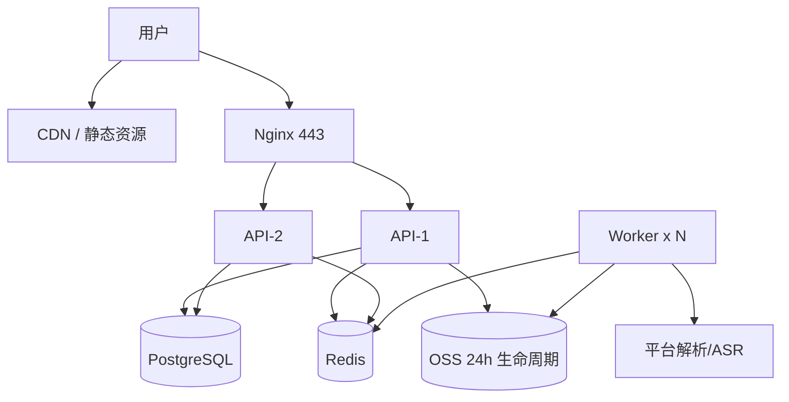

# 部署与成本

## 0. 关键路径（先做这个，否则后面全卡）

| 事项 | 耗时 | 何时开始 |
|---|---|---|
| **ICP 备案**（域名 + 服务器） | 7-20 个工作日 | **第 1 天** |
| 小程序认证（300 元/年） | 1-3 天 | 第 1 天 |
| 类目选择与资质 | 1-3 天 | 第 1 周 |
| 软件著作权（APP 上架用） | 30 个工作日（可加急） | 第 2 周 |
| Apple 开发者账号（$99） | 1-7 天 | 第 6 周 |
| 支付商户号（微信/支付宝） | 3-10 天 | 第 4 周 |

**备案没下来，小程序就不能配 request 域名，真机全部报错。** 这是最容易低估的一步。

## 1. 服务器规格

### MVP（1k DAU）
| 角色 | 规格 | 数量 | 月费（估算） |
|---|---|---|---|
| API + Worker | 4C8G / 100G SSD | 1 | 250-400 元 |
| PostgreSQL | 2C4G / 100G | 1（可与 API 同机） | 150-300 元 |
| Redis | 1G 标准版 | 1 | 80-150 元 |
| OSS | 100G 存储 + 流量 | — | 50-150 元 |
| 带宽 | 5Mbps 固定 | — | 100-200 元 |
| 域名 + 证书 | .com + 免费 DV | 1 | 60 元/年 |
| **合计** | | | **约 700-1,200 元/月** |

### 成长（1w DAU）
| 角色 | 规格 | 数量 | 月费（估算） |
|---|---|---|---|
| API | 4C8G | 2 | 800 元 |
| Worker | 8C16G | 3 | 2,400 元 |
| PostgreSQL | 4C8G 高可用 | 1 | 1,200 元 |
| Redis | 4G 集群 | 1 | 500 元 |
| OSS + CDN | 1TB | — | 600 元 |
| ASR | 按量 3,000 小时/月 | — | 2,400-7,500 元 |
| **合计** | | | **约 8,000-13,000 元/月** |

## 2. 部署拓扑



## 3. 小程序侧配置（缺一不可）

1. 微信公众平台 → 开发管理 → 服务器域名：
   - `request 合法域名`：`https://api.你的域名.com`
   - `uploadFile 合法域名`：同上
   - `downloadFile 合法域名`：OSS 自定义域名（**不要用默认域名**，腾讯 COS 默认域名会强制下载）
2. 业务域名（如需 webview）：`https://你的域名.com`
3. 隐私保护指引：收集"设备信息、相册、麦克风、文件"，逐项说明用途。
4. 类目：`工具 → 效率` 或 `工具 → 信息查询`；**不要选"视频/影视"**，会触发内容资质。
5. 版本审核备注（直接抄）：
   > 本小程序为个人学习用途的文案整理工具。用户粘贴自己有权访问的公开链接，系统仅提取其中的语音并转写为文字，不提供视频下载、不提供去水印、不存储原视频（24 小时内自动删除）。已接入内容安全接口。

## 3.1 内容安全（审核最容易卡的一关）

小程序提审前必须接通微信内容安全，否则「用户可自由输入文本 / 上传音视频」这类能力会被直接驳回。

### 三档开关

| `SEC_CHECK` | 行为 | 用在哪 |
|---|---|---|
| `auto`（默认） | 配了 `WX_MP_APPID` + `WX_MP_SECRET` 就开启，没配就关闭 | 生产 |
| `off` | 强制关闭，不调用微信接口 | 本地开发 |
| `enforce` | 强制开启，未配置直接报 503（不会静默放过） | 上线前置验收 |

`GET /api/health` 会返回 `"sec_check": "off|enforce"`，一眼确认当前状态。

### 文本检测（msgSecCheck）

- 用户提交的链接/分享文案：进 `/api/parse` 先查，risky 直接 400 `CONTENT_RISKY`，**不扣任何次数**。
- 转写出来的全文：任务跑到「内容检测」阶段再查一次，拦截则任务 `failed / CONTENT_RISKY`，**自动退回次数**并清空全文。
- 单条 2000 字分片，最多 40 片（约 8 万字），超过部分不再送检。

### 音频/视频检测（mediaCheckAsync）

- 音频在上传完成时送机审，`media_type=1`。
- 微信要求两个硬条件，缺一不可：
  1. `media_url` 必须是 **HTTPS**（本项目用 `PUBLIC_BASE_URL` 拼签名音频地址）；
  2. 回调地址必须公网可达：`https://你的域名/api/sec/callback?k=$SEC_CALLBACK_TOKEN`。
- 没满足时：`auto` 模式跳过机审（仅靠转写后的文本检测兜底）；`enforce` 模式返回 503，宁可不让传也不放过。
- 回调建议在微信公众平台「开发管理 → 消息推送」里配置，或确认回调 URL 未被防火墙拦截。

### 配置

```bash
SEC_CHECK=auto
SEC_CALLBACK_TOKEN=<长随机串>
PUBLIC_BASE_URL=https://api.你的域名.com
```

`SEC_MOCK=pass|risky|review` 只用于测试，**生产必须留空**，否则等于关掉真实检测。

### 本地怎么验

```powershell
cd 06-代码\server
.\.venv\Scripts\python.exe tests\smoke_sec.py   # 期望 SEC_PASS
```

脚本会在 8792/8793 临时起两个实例，分别模拟 risky / pass，跑完自动关闭主服务以外的进程。

## 3.2 增长：签到 / 邀请 / 激励视频

### 规则（已实现）

| 玩法 | 用户得到 | 平台成本 | 风控 |
|---|---|---|---|
| 每日签到 | +1 次链接提取 | 0 | 每天 1 次；连续 7 天额外 +5 |
| 看激励视频 | +1 次链接提取，每天最多 5 次（后台可改 0-20） | 广告收入 > AI 成本 | 开始→至少 15 秒→完成，一次性 token |
| 邀请好友 | 双方各 +3 次 | 0 | 注册 3 天内可绑；不能绑自己；一人只能绑一次 |
| 好友首次付费 | 邀请人 +7 天会员 | 0 现金支出 | 只发一次；兑换码不触发 |

**微信生态红线**：不要做现金/二级分销。PRD 和代码都只返「次数 + 会员天数」，这是合规做法。
如果以后做 APP / 海外版，可以在这套 `invites` 表上叠加现金分佣，但要单独做提现、税务和 KYC。

### 激励视频怎么开

1. 小程序后台 → 流量主 → 开通（需要一定累计用户/UV，按微信当期规则）；
2. 新建「激励视频」广告位，拿到 `adunit-xxxxxxxx`；
3. 填 `AD_UNIT_ID`，重启服务；
4. `GET /api/health` 的 `ad_enabled` 变 true，前端按钮从「未开通」变「看视频 +1」。

没有广告位时功能自动隐藏，不影响签到和邀请。

### 防刷说明

激励视频没有可用的服务端「看完」回调，本项目用「`/start` 发一次性 token → 服务端计时 ≥15 秒 → `/finish` 发奖」兜底，
能挡住直接刷接口；挡不住改客户端时间/模拟器，所以还有每日上限（默认 5 次）兜底。
真要做强风控，需要接广告平台的服务端回调（如有）或设备指纹，MVP 不必。

### 后台

`/admin` → 功能额度 → 激励视频：改每日上限，立即生效。
手机端：管理后台 → 额度 → 激励视频。

## 4. 上线步骤（按顺序）

```powershell
# 1. 服务器初始化（Ubuntu 22.04）
apt update && apt install -y docker.io docker-compose-plugin nginx certbot python3-certbot-nginx ffmpeg
# 2. 拉代码（整仓，Docker 构建上下文是仓库根目录）
git clone <repo> /opt/script-studio && cd /opt/script-studio/07-部署
# 3. 配环境变量
cp .env.example .env && vim .env
# 4. 起服务（context=..，dockerfile=07-部署/Dockerfile）
docker compose up -d --build
# 5. 证书
certbot --nginx -d api.你的域名.com
# 6. 自检
curl https://api.你的域名.com/api/health
```

### 为什么是单 worker

上传分片会话（`SESSIONS`）目前存在进程内存，`--workers 2` 会让分片请求落到另一进程直接 404。
容器里固定 `--workers 1`；要扩多进程，先把 `SESSIONS` 挪到 Redis/数据库，再按 CPU 扩。

### 构建自检

```bash
cd 07-部署
docker compose config          # 校验 compose
docker compose build           # 需要仓库根目录参与构建
docker compose up -d
curl http://127.0.0.1:8000/api/health
```

## 5. 必须配置的运维项

| 项 | 配置 |
|---|---|
| OSS 生命周期 | `work/` 前缀 24 小时删除；`exports/` 7 天删除 |
| 数据库备份 | 每日全量 + binlog，保留 7 天；每月做一次恢复演练 |
| 日志 | 按天切割，保留 30 天；错误日志单独告警 |
| 监控 | 解析成功率（分平台）、任务 P95、ASR 失败率、队列积压、5xx 率 |
| 告警 | 解析成功率 <70% 持续 10 分钟 → 企业微信/短信 |
| 限流 | Nginx `limit_req` + 应用层用户维度 |
| 灰度 | 新解析器先对 5% 流量，成功率达标再全量 |

## 5.1 成本闸门（必须开着）

| 闸门 | 默认 | 作用 |
|---|---|---|
| `FREE_MAX_SECONDS` | 600 秒 | 免费用户单条最长 10 分钟，超限直接失败并退次数 |
| `MAX_DURATION_SEC` | 10800 秒 | 会员 / 自带 ASR Key 的硬上限 3 小时 |
| `MAX_UPLOAD_MB` | 2048 | 单文件体积上限 |
| `FREE_DAILY_QUOTA` | 20 | 每用户每日任务数上限（签到会 +1） |
| `AD_REWARD_DAILY` | 5 | 每人每天看视频领次数上限 |

时长在**转写之前**判断，超限不会产生 ASR 费用。这是最容易漏、也最容易亏钱的一环。

## 6. 解析服务的运维（这是长期成本）

- 每个平台一个 adapter，独立开关：`PLATFORM_DOUYIN_ENABLED=1`。
- 失败率超过阈值自动熔断，前端提示"改用上传"，而不是一直转圈。
- Cookie/账号池按平台隔离，失效自动摘除并告警。
- 每周一次回归：每平台 10 条固定样本，跑通率写入看板。
- **预算**：每月预留 2-4 人天做解析维护，或外包 3,000-6,000 元/月。

## 7. 上线检查清单

- [ ] ICP 备案通过，域名可访问
- [ ] HTTPS 证书自动续期（`certbot renew --dry-run`）
- [ ] 小程序三个域名全部配置且已生效（真机验证，不是开发者工具）
- [ ] 隐私指引、用户协议、侵权投诉入口齐全
- [ ] 内容安全接口联通，20 条敏感样本全部拦截
- [ ] 支付回调验签通过，重复回调不重复发货
- [ ] iOS 端无购买入口
- [ ] OSS 生命周期规则生效（上传一个文件，24h 后确认消失）
- [ ] 备份可恢复（在测试库还原一次）
- [ ] 压测：100 并发下单任务，无超卖、无重复扣次


## 8. 支付与额度上线配置

### 8.1 商品与到账

| SKU | 价格 | 到账 |
|---|---|---|
| `credits_30` | ¥9.90 | 30 次 |
| `credits_300` | ¥39.00 | 300 次 |
| `credits_3600` | ¥399.00 | 3,600 次 |
| `byok_month` | ¥19.00 | 30 天 BYOK 会员 |
| `byok_year` | ¥128.00 | 365 天 BYOK 会员 |
| `team_month` | ¥99.00 | 30 天团队版 |

### 8.2 微信支付 v3 必填

| 变量 | 说明 |
|---|---|
| `WECHATPAY_MCHID` | 商户号 |
| `WECHATPAY_APPID` | 小程序/APP AppID |
| `WECHATPAY_SERIAL_NO` | 商户 API 证书序列号 |
| `WECHATPAY_PRIVATE_KEY_PATH` | `apiclient_key.pem` 路径 |
| `WECHATPAY_APIV3_KEY` | APIv3 密钥（32 位） |
| `WECHATPAY_NOTIFY_URL` | `https://api.域名/api/pay/notify/wechat` |
| `WECHATPAY_PLATFORM_CERT_PATH` | 微信平台证书（回调验签） |

未配置时：下单返回 `pay.mode=manual`，前端引导兑换码；不影响其他功能。
`DEV_MODE=1` 时：返回 `mock`，可用 `/api/orders/{id}/mock-pay` 直接入账（**生产必须为 0**）。

### 8.3 回调安全

- 验签：`Wechatpay-Timestamp/Nonce/Signature` + 平台证书 RSA-SHA256。
- 解密：APIv3 密钥 AES-256-GCM。
- 幂等：订单 `pending → paid` 条件更新，重复回调不重复加额度。
- 金额校验：回调金额 ≠ 订单金额直接拒绝。

### 8.4 火山 ASR

- 配置 `PUBLIC_BASE_URL=https://api.域名`，服务端会生成 1 小时有效的音频签名 URL。
- 用户 Key 格式：`AppID:AccessToken:Cluster`，默认 Cluster `volc_auc_common`。
- 服务端自动转 16k 单声道 wav，再提交 `/api/v1/auc/submit` 并轮询。

## 9. 链接回归

- `tests/links.template.csv` 有 60 行空位，按平台填真实链接。
- 跑 `python tests/link_matrix.py --timeout 180`，输出按平台成功率。
- 建议每周固定跑一次，成功率跌破阈值就补 Cookie 或换解析方案。


## 10. 手机端管理后台

### 10.1 配置

```bash
# 创始管理员（微信登录后的 user_id / openid），逗号分隔
ADMIN_USER_IDS=oXXXXXXXXXXXXXXXXXXXXXXX
# 网页后台密码，可保留给运营在电脑上用
ADMIN_PASSWORD=change-me-strong
ADMIN_SECRET=another-long-random-string
```

留空 `ADMIN_USER_IDS` 时，第一个打开「我的 → 管理后台」的人可以认领一次管理员；认领后名单写入 `admins` 表，不再允许认领。

### 10.2 添加协管员

- 小程序：我的 → 管理后台 → 更多 → 协管员 → 填对方 user_id
- 网页：/admin → 协管员 → 填 user_id
- 对方重新打开小程序，就能在「我的」看到管理入口，不需要密码

### 10.3 APP 内嵌后台（免密）

APP 已经登录的情况下，先换一个短期 token：

```js
const r = await uni.request({
  url: BASE_URL + "/api/admin/app-token",
  method: "POST",
  header: { "Authorization": "Bearer " + userToken }
});
const token = r.data.token;
// token 放在 # 片段里，不会进服务器访问日志
uni.navigateTo({
  url: "/pages/webview/webview?src=" +
       encodeURIComponent(BASE_URL + "/admin#t=" + token)
});
```

webview 页面直接 `<web-view :src="src" />` 即可。token 12 小时有效，退出登录时清掉。

### 10.4 上线前

已接真实登录：APP 用 `uni.login` 换 token，管理接口认 `Authorization: Bearer <userToken>`。配置见第 11 节。


## 11. 登录与真实身份（上线必做）

### 11.1 小程序登录怎么走

```
小程序 wx.login()
   → code
   → POST /api/auth/wechat {code, platform:"mp"}
   → 服务端 GET https://api.weixin.qq.com/sns/jscode2session
   → 拿到 openid
   → 服务端签 30 天 HMAC token（AUTH_SECRET）
   → 小程序存 storage，之后所有请求带 Authorization: Bearer <token>
```

- `session_key` 只在服务端用，绝不返回给前端。
- token 里只有 `user_id/openid + 渠道 + 过期时间`，没有昵称头像。
- 401 时小程序会自动清 token、重新 `wx.login` 并重试一次。

### 11.2 配置

```bash
AUTH_SECRET=<随机 32 位以上字符串>
WX_MP_APPID=wx1234567890abcdef
WX_MP_SECRET=<小程序后台的 AppSecret>
```

重启后访问 `GET /api/health`，看到 `"wx_login": true` 即配置成功。

AppSecret 只放服务器环境变量，**不要**写进小程序代码、仓库或聊天记录。

### 11.3 小程序后台还要做

1. 开发管理 → 开发设置 → 服务器域名 → request 合法域名，加入 `https://api.example.com`
2. 业务域名按需配置（如果有 webview）
3. `utils/api.js` 的 `BASE_URL` 改成 `https://api.example.com`

### 11.4 APP 登录

uni-app 打包的 APP 用 `uni.login({provider:"weixin"})` 拿 code，调同一个接口，`platform` 传 `"app"`。服务端读 `WX_APP_APPID / WX_APP_SECRET`。

没有微信开放平台 APP 时，可以先只上小程序。

### 11.5 本地为什么还能用 demo

`DEV_MODE=1` 且请求来自 `127.0.0.1/localhost` 时，小程序登录失败会回退到 `X-User-Id: demo`。这是为了没有 AppID 也能演示。

**生产环境必须 `DEV_MODE=0`**，否则 `X-User-Id` 可以被任意伪造。

### 11.6 常见错误

| 微信 errcode | 原因 |
|---|---|
| 40013 | AppID 不对，或小程序和 App 的 AppID 用混了 |
| 40125 | AppSecret 不对 |
| 45011 | 登录频率限制，稍后再试 |
| 40226 | 高风险用户，被微信拦截 |
| -1 | 微信系统繁忙，重试 |
